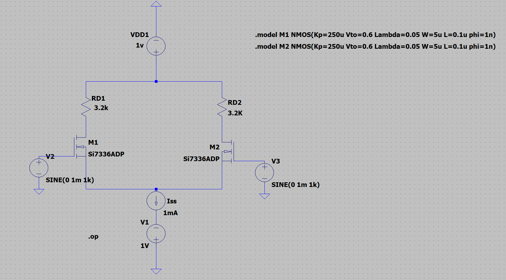
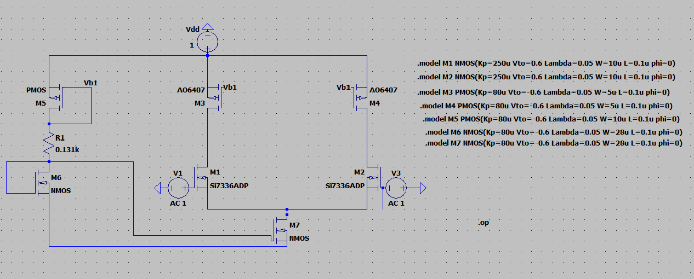
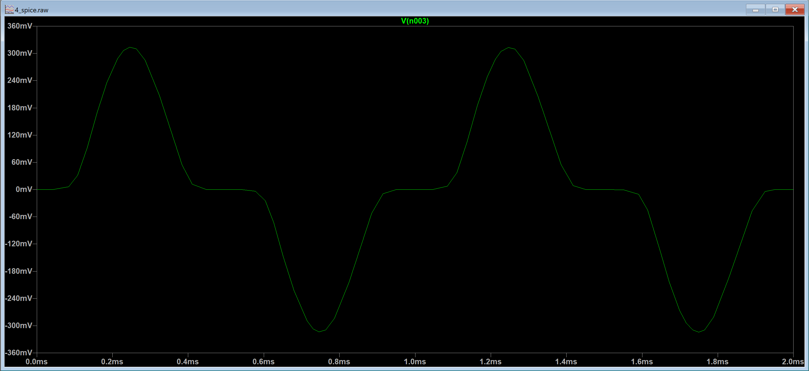
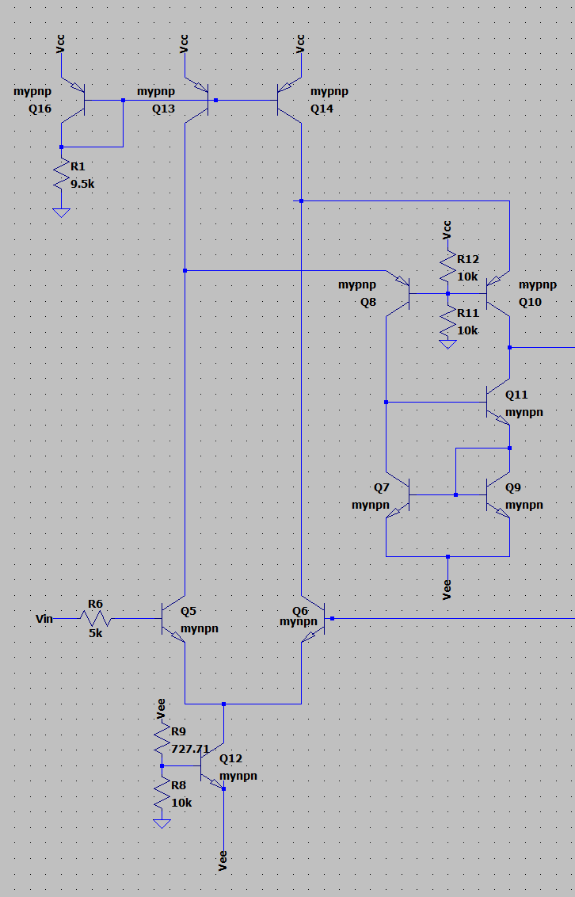
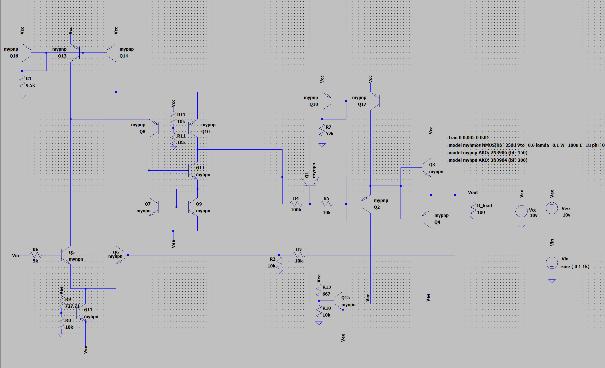
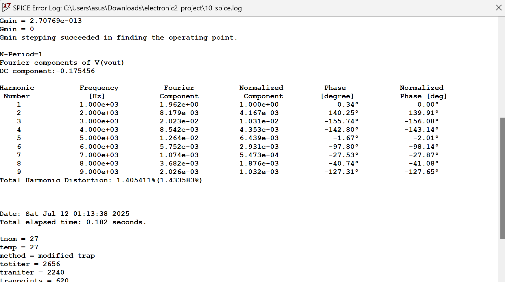
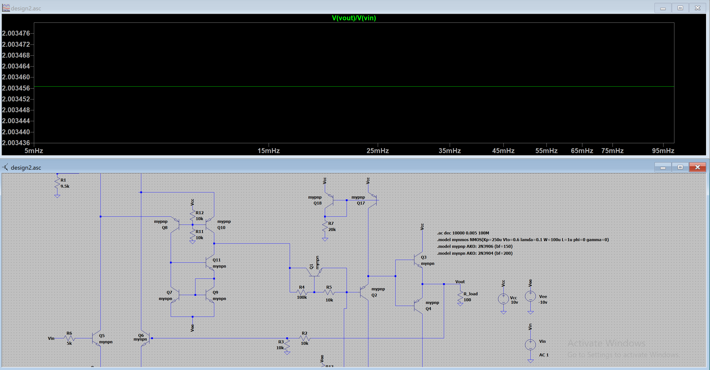
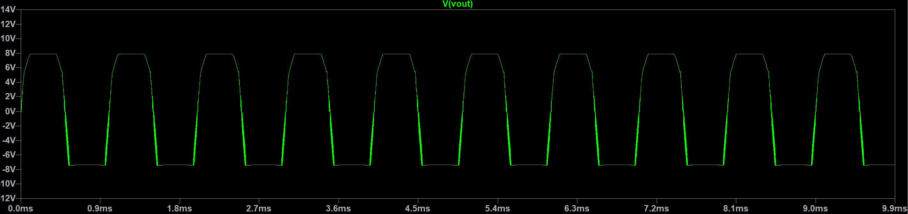

# Analog Amplifier Design and Optimization

Two-phase Electronics II course project at Sharif University of Technology (2025). The project explores transistor-level differential amplifiers, bias circuits, and a feedback power amplifier, progressing from MOSFET differential pairs to a folded-cascode input stage with transistor-based biasing. All original schematics and reports are preserved; the results below are taken from the submitted reports and saved LTspice outputs, not a new simulation run.

**Author:** Aynaz Rezaeizadeh  
**Tools:** LTspice XVII, MOSFET/BJT circuit analysis, SPICE simulation.

## Phase 1 — MOSFET differential amplifiers

Four configurations were analyzed theoretically and simulated in LTspice. The study covers DC operating points, differential and common-mode gain, input/output resistance, voltage swing, power consumption, and common-mode range where applicable. The original report compares theoretical and simulated values; the handwritten analysis records the derivations.

| Configuration | Schematic | Main design change |
|---|---|---|
| 1 | [1.asc](phase-1-differential-amplifiers/ltspice/1.asc) | NMOS differential pair with 1.6 kΩ resistive loads |
| 2 | [2.asc](phase-1-differential-amplifiers/ltspice/2.asc) | PMOS active loads |
| 3 | [3.asc](phase-1-differential-amplifiers/ltspice/3.asc) | Current-mirror-based active loading/biasing |
| 4 | [4.asc](phase-1-differential-amplifiers/ltspice/4.asc) | Transistor-based tail-current bias network |

[Original Phase 1 report (DOCX)](phase-1-differential-amplifiers/reports/report.pdf) · [Handwritten circuit analysis (PDF)](phase-1-differential-amplifiers/reports/handwritten-analysis.pdf)

## Phase 2 — Power amplifier and folded-cascode redesign

The original circuit combines a differential input stage, a BJT output stage and negative feedback. The experiments investigate crossover distortion, bias current, clipping, transistor operating points, and harmonic distortion. The redesign replaces the input stage with a folded-cascode topology and implements transistor-based bias/current-source circuits instead of ideal independent sources other than the supply rails.

| Experiment | Original LTspice file |
|---|---|
| Output stage and crossover distortion | [4_spice.asc](phase-2-power-amplifier/ltspice/4_spice.asc) |
| DC operating point | [7_spice.asc](phase-2-power-amplifier/ltspice/7_spice.asc) |
| Large-input transient | [8_spice.asc](phase-2-power-amplifier/ltspice/8_spice.asc) |
| Bias-current variation | [9_spice.asc](phase-2-power-amplifier/ltspice/9_spice.asc) |
| Fourier/THD analysis at 1 kHz | [10_spice.asc](phase-2-power-amplifier/ltspice/10_spice.asc) |
| Redesigned circuit, transient setup | [design.asc](phase-2-power-amplifier/ltspice/design.asc) |
| Revised bias configuration, AC setup | [design2.asc](phase-2-power-amplifier/ltspice/design2.asc) |

### Recorded simulation results

| Metric | Recorded value | Evidence / interpretation |
|---|---:|---|
| Supply rails | +10 V / −10 V | Phase 2 schematics |
| Load resistance | 100 Ω | Phase 2 schematics |
| Baseline input | 1 V peak, 1 kHz | `10_spice.asc` |
| Baseline output fundamental | 1.962 V | `10_spice.log` |
| Baseline THD | 1.405411% | Fourier analysis of `10_spice` (not the final redesign or specified full-swing test) |
| Redesigned low-frequency closed-loop voltage gain | ≈ 2.00346 V/V | Original gain screenshot, report p. 14 |
| Reported output swing | 16.8 V peak-to-peak | Report p. 14; clipping/swing experiment, not a verified low-distortion swing |
| Reported supply power | ≈ 45 mW per rail, ≈ 90 mW total | Report p. 15; sum of the two rails |

The stored `design2.op.raw` operating point also gives approximately 4.559 mA from the positive rail and 4.450 mA from the negative rail (magnitudes), corresponding to approximately 90.09 mW total at ±10 V. This is consistent with the rounded report values.

### Design limitations and reproducibility

- The redesigned gain is close to the nominal target of 2 V/V. The reported swing of 16.8 Vpp exceeds the nominal 16.6 Vpp swing target numerically, but the saved evidence does not establish distortion-free operation at that swing.
- The reported total supply power of about 90 mW exceeds the nominal 50 mW quiescent-power target. The final redesign's THD at 16.4 Vpp is not documented in the supplied report; the baseline THD must not be interpreted as that result. Therefore full design-target compliance is not claimed.
- Several original Phase 2 MOSFET model directives spell `lambda` as `lamda`. The saved logs explicitly show this parameter being ignored and also contain short-channel-length and initial convergence warnings. Gmin stepping succeeded in the recorded runs where needed. Original directives are preserved, not silently corrected.
- Phase 1 uses built-in device names (`Si7336ADP`, `AO6407`) in the schematics while separate `.model M1 ...`-style directives are present. The actual model binding should be checked in LTspice before interpreting the theoretical/model comparison as validated.
- `design2.asc` currently contains an AC analysis directive, but its supplied `design2.raw` header identifies a transient run. The original AC gain screenshot is preserved independently; re-run the AC analysis to reproduce it rather than treating that RAW file as an AC result.
- The circuits were simulated; physical fabrication and laboratory validation are not claimed. No fresh LTspice runs were performed for this repository preparation.

[Original Phase 2 report (PDF)](phase-2-power-amplifier/reports/report.pdf) · [Original THD log](phase-2-power-amplifier/ltspice/10_spice.log)

## Running the simulations

1. Install LTspice (the saved outputs were produced by LTspice XVII).
2. Open any `.asc` schematic in its corresponding `ltspice` folder.
3. Inspect the model directives and component models, then run the configured `.op`, `.dc`, `.tran`, or `.ac` analysis.
4. Select the desired voltage/current traces; for the baseline THD case, inspect View → SPICE Error Log after running `10_spice.asc`.

The original Phase 2 `.raw`, `.op.raw`, `.fft`, and `.log` files are included for reference. Some contain original local file paths. Saved raw files may reflect earlier schematic settings. The Phase 1 report and handwritten derivations are in Persian, as is the Phase 2 report. Selected original screenshots are provided separately for convenient browsing. The source reports retain their original contents.
